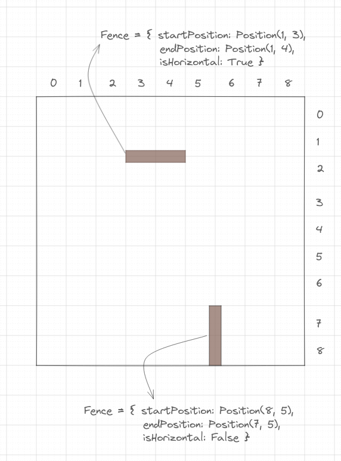

= Projet Quoridor

Avant de commencer, installez les dépendances nécessaires grâce à la commande{nbsp}:

[source,shell]
----
npm install
----

== Commandes 

|===

| Commande | Description

| `npm run clean`
| Supprimes les fichiers compilés et auxiliaires

| `npm run clean-deps`
| Supprimes les dépendances 

| `npm run command-line`
| Exécute le jeu en mode ligne de commande

| `npm run start-server`
| Exécute le jeu en mode serveur web

| `npm run test`
| Lance tous les tests unitaires du projet avec Alsatian

|===

== Objectif du Jeu

Quoridor est un jeu de stratégie où l'objectif principal est d'amener son pion à la ligne opposée du plateau avant ses adversaires. Le premier joueur à atteindre sa ligne opposée remporte la partie.

Une partie de Quoridor se joue généralement avec 2 à 4 joueurs. Il existe 20 barrières qui sont distribuées de manière équitable entre les joueurs avant le début de la partie.

== Déplacements des Pions

Les joueurs peuvent déplacer leur pion d'une case à la fois dans les directions suivantes :

- Vers le haut
- Vers le bas
- Vers la gauche
- Vers la droite

**Les pions ne peuvent pas se déplacer en diagonale.**

== Obstacles : Les Barrières

Pour compliquer les déplacements, les joueurs peuvent placer des barrières sur le plateau. Une barrière est constituée de deux segments et peut être placée horizontalement ou verticalement entre deux cases adjacentes. Les barrières bloquent le passage des pions.

=== Description 

Dans le jeu Quoridor, une barrière est représentée par une structure de données appelée Fence. Chaque Fence est définie par les deux positions adjacentes nécessaires pour placer la barrière.

=== Représentation des Barrières dans le Jeu Quoridor

- Une barrière horizontale est définie par les positions adjacentes qui se trouvent en haut de la barrière. **Elle ne peut pas être placée le long des limites supérieure et inférieure du plateau.**
- Une barrière verticale est définie par les positions adjacentes qui se trouvent à gauche de la barrière. **Elle ne peut pas être placée le long des limites gauche et droite du plateau.**

La structure Fence comprend les champs suivants :
====
    startPosition: Position de début de la barrière.
    endPosition: Position de fin de la barrière.
    isHorizontal: Booléen indiquant si la barrière est horizontale (true) ou verticale (false).
====

Dans la représentation d'une barrière, l'ordre dans lequel les positions sont fournies n'a pas d'incidence sur son orientation. En d'autres termes, il n'y a pas de notion d'orientation associée à la représentation d'une barrière.

====
.Représentation graphique des barrières horizontales et verticales dans le système.

====

== Règles de Déplacement
- Un joueur peut déplacer son pion d'une case adjacente horizontalement ou verticalement, à condition que la case de destination ne soit pas bloquée par une barrière.
- Les pions ne peuvent pas traverser les barrières. Si une barrière bloque le chemin, le joueur doit contourner celle-ci.
- Un pion peut sauter par-dessus un pion adverse si la case juste derrière le pion est libre.
- Les pions ne peuvent pas sortir du plateau.
- Chaque joueur ne peut placer qu'une barrière par tour.
